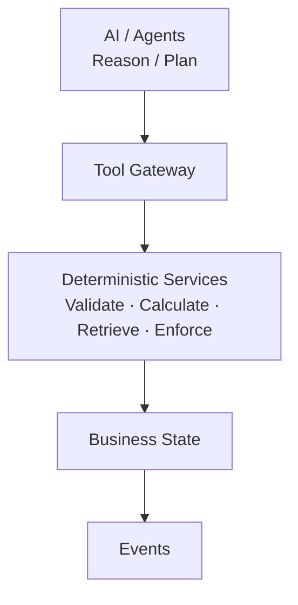
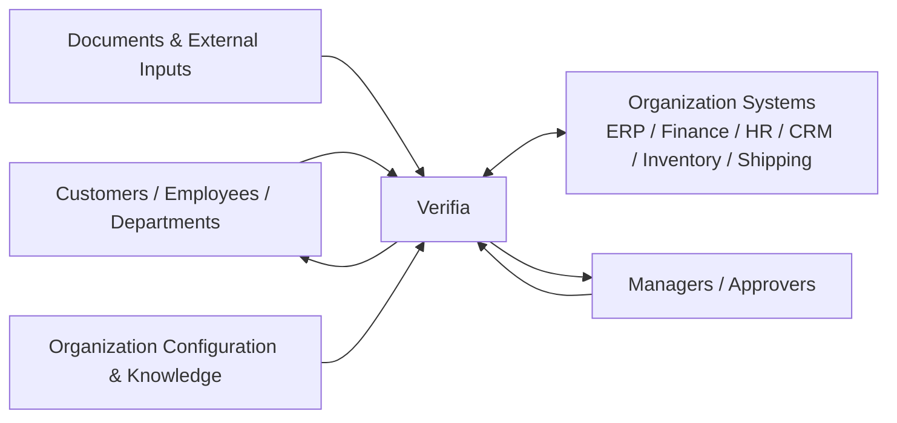
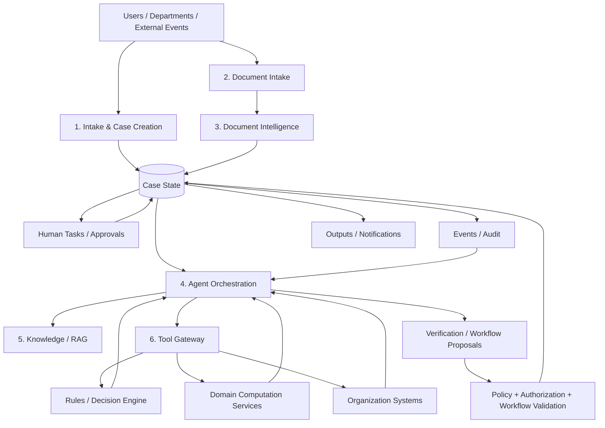

# VerifiaAI Documentation — Part 1: Product Overview

*Back to [index](00-README.md) · Next: [Architecture & AI Agent Design →](02-architecture.md)*

---

## 1. Executive Summary

**Verifia is a configurable agentic business-process verification and orchestration platform for organizations whose processes depend heavily on documents, evidence, rules, calculations, and human decisions.**

Verifia is not primarily a customer-service automation platform. It is designed to operate across organizational processes, including processes that happen entirely inside a company.

Examples include:

- Finance: income verification, liabilities, reconciliation, tax calculations and invoice verification.
- Legal: contract review, clause verification and document compliance.
- Tax / Compliance: regulatory checks, evidence collection and policy verification.
- HR: employee-document and payroll-related workflows.
- Procurement: vendor verification and quotation checks.
- Insurance: claims processing and evidence verification.
- Import / Export: trade-document verification, inventory checks, finance review and shipping workflows.
- Internal audit and operations: evidence-driven investigations and approvals.

### One-sentence definition

> **Verifia automates and orchestrates business processes that require understanding, verification, evidence, rules, calculations, and human decisions.**

### Core principle

```text
UNDERSTAND → VERIFY → ORCHESTRATE → ACT → VERIFY → CONTINUE / ESCALATE
```

### Guiding architecture rule



The LLM is **not the source of truth**. The source of truth is organizational data, documents, configured rules and policies, workflow state, deterministic computation, authoritative system results, and human decisions.

> **AI provides flexible reasoning; deterministic systems provide reliable verification and execution; humans provide authoritative judgment.**

---

## 2. Product Definition

### System Context Diagram

The context view shows Verifia as the controlled business-process intelligence layer between people, organizational systems, and the organization's configured processes and knowledge.



### 2.1 What Verifia is

Verifia is a configurable business-process engine with an agentic intelligence layer. It connects:

- people,
- documents,
- extracted information,
- organizational knowledge,
- deterministic verification,
- calculations,
- business rules,
- workflow state,
- company systems,
- tasks,
- approvals,
- and audit history.

### 2.2 What Verifia is not

Verifia is deliberately not:

- just a chatbot,
- just an OCR system,
- just a RAG application,
- just an LLM wrapper,
- just a rules engine,
- or just a workflow-management tool.

Its value comes from combining these capabilities into a controlled execution model.

### 2.3 The central product principle

> **Verifia doesn't automate a department. It automates and orchestrates business processes that require understanding, verification, evidence, rules, calculations, and human decisions.**

The department is a participant in a process, not the primary abstraction.

---

## 3. The Problem

### Level-1 Data Flow Diagram

This DFD summarizes how requests, documents, knowledge, deterministic services, human decisions, and business state move through Verifia.



Organizations routinely process large volumes of structured, semi-structured and unstructured information:

- PDFs and scanned documents
- images
- Excel and CSV files
- invoices and purchase orders
- contracts and reports
- emails and messages
- forms and internal records
- data retrieved from company systems

A single business case may pass through several employees and departments.

### Typical manual process

```text
Request
  ↓
Document Collection
  ↓
Employee Reads Documents
  ↓
Information Extraction
  ↓
Requirement Checks
  ↓
Cross-Document Comparison
  ↓
Calculations / Rules
  ↓
Department Review
  ↓
Manager Approval
  ↓
Execution
  ↓
Notification
```

### Recurring problems

1. High processing time.
2. Repetitive manual work.
3. Data-entry errors.
4. Calculation errors.
5. Missing documents.
6. Inconsistent information between documents.
7. Difficulty determining the next step.
8. Poor visibility into case status.
9. Repeated human follow-up.
10. Limited auditability of why a decision was reached.

Verifia addresses these problems by making business processes **document-aware, evidence-driven, rule-aware, calculation-aware, and AI-assisted**.

---

## 4. Product Scope and Boundaries

### 4.1 Generic core

The core platform provides reusable capabilities:

- Case Management
- Agent Orchestration
- Document Intelligence
- Verification Framework
- Workflow Engine
- Rules / Decision Engine
- Domain Computation Services
- Knowledge / RAG
- Task Management
- Approval Management
- RBAC / Authorization
- Audit / Observability
- Tool Gateway
- Model Gateway
- Organization Integration interfaces

### 4.2 Organization configuration

Each organization defines its own:

- processes,
- process versions,
- stages,
- requirements,
- verifications,
- rules,
- calculations,
- approval policies,
- roles,
- departments,
- routing rules,
- permissions,
- knowledge,
- and integration mappings.

### 4.3 Organization integrations

Verifia can connect to organizational systems through controlled adapters, for example:

- ERP
- accounting / finance
- CRM
- HR
- inventory
- banking
- shipping
- document management
- internal APIs

### 4.4 Configuration is not hard-coded domain logic

Bad:

```python
if workflow == "import_order":
    ...
```

Good:

```text
Process Definition
      ↓
Process Version
      ↓
Configured Stages / Requirements / Verifications / Rules
      ↓
Generic Verifia Engine
```

Import / Export is therefore a **demonstration configuration**, not the definition of Verifia.

---

## 5. Core Concepts

### 5.1 Organization

A tenant representing a company or organizational environment.

### 5.2 Process

A reusable definition of a business process.

Example:

```text
Tax Verification
Import Order Verification
Contract Review
Invoice Verification
```

### 5.3 Process Version

A versioned, immutable/published definition of a Process used by Cases.

### 5.4 Case

> **A Case is a particular instance of a business process that Verifia is responsible for understanding, verifying, deciding/authorizing, and moving toward completion.**

A Case is an execution of a Process.

```text
PROCESS
Tax Verification
   │
   └── v2
        │
        ├── Case #1042
        ├── Case #1043
        └── Case #1044
```

### 5.5 Stage

Answers:

> **Where are we in the business process?**

A Stage represents business state, not work.

### 5.6 Requirement

Answers:

> **What must be available or true before the case can proceed?**

### 5.7 Verification

Answers:

> **What business question are we trying to establish?**

### 5.8 Rule

Answers:

> **Given information, what deterministic condition must hold?**

### 5.9 Calculation

A deterministic domain computation used to derive or validate a value.

### 5.10 Task

Answers:

> **What specific work must a human or system perform?**

### 5.11 Approval

A specialized human decision requiring an authorized role and an auditable decision.

### 5.12 Evidence

The source material supporting an extracted value, verification result, calculation, or decision.

### 5.13 Event

A record that something happened in the system.

---


---

*Back to [index](00-README.md) · Next: [Architecture & AI Agent Design →](02-architecture.md)*
