# VerifiaAI Documentation — Part 2: Architecture & AI Agent Design

*Back to [index](00-README.md) · Previous: [Product Overview](01-product-overview.md) · Next: [Database Schema →](03-database-schema.md)*

---

## 6. The Three-Layer Architecture

### Three-Layer Architecture Diagram

The platform separates reusable engine capabilities from organization-specific configuration and from the systems that an organization already operates.

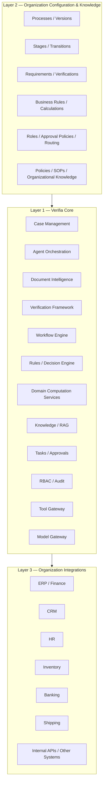

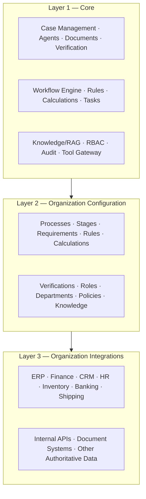

### Design principle

> **The organization defines what is authoritative; AI determines how to navigate the information surrounding it.**

Business onboarding is performed by the Verifia team rather than requiring a business user to construct arbitrary workflows in an admin UI:

```text
Organization wants Verifia
          ↓
Business Analysis
          ↓
Understand Processes / Policies / Systems
          ↓
Verifia Configuration
          ↓
Configured Organization Instance
```

---

## 7. Organization Configuration

Configuration is data-driven.

### Configuration areas

```text
Organization
├── Processes
│   └── Process Versions
│       ├── Stages
│       ├── Transitions
│       ├── Requirements
│       ├── Verifications
│       ├── Rules
│       └── Calculations
│
├── Roles / Departments / Permissions
├── Approval Policies
├── Routing Policies
├── Knowledge
└── Integration Definitions
```

A process can therefore be configured without rebuilding the Verifia engine.

---

## 8. Business Case Model

### Level-2 Case Processing DFD

A Case is the runtime center of Verifia. This view expands what happens to one case as information is collected, interpreted, verified, reviewed, and advanced.

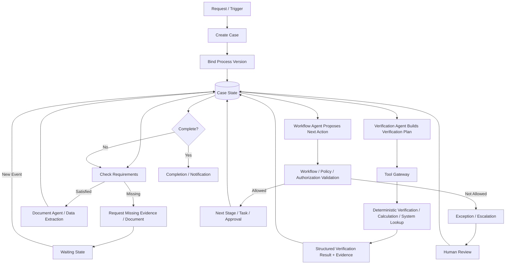

The Case is the central runtime object.

```text
CASE
├── Request
├── Participants
├── Documents
├── Extracted Information
├── Evidence
├── Verification Results
├── Tasks
├── Decisions / Approvals
├── Tool Results
├── Workflow State
└── History / Events
```

A Case may be initiated by:

- customer,
- employee,
- department,
- scheduled process,
- external system,
- or another Case/process.

A customer is therefore optional.

### Case lifecycle

```text
Process Version
      ↓
Case Created
      ↓
Initial State
      ↓
Agent / Tools / Humans
      ↓
Verification
      ↓
Workflow Validation
      ↓
New State
      ↓
Event
      ↓
Continue / Wait / Escalate
```

---

## 9. Process Model

A Process Version consists of five major areas.

### A. Trigger

What starts the process:

- user request,
- employee action,
- scheduled job,
- external system event,
- completion of another process.

### B. Inputs / Documents / Evidence

What the process requires.

Example — Tax Verification:

```text
Financial Statement
Revenue Report
Expense Report
Previous Tax Filing
Supporting Invoices
```

### C. Verifications

Business questions that must be established.

Example:

```text
Income Reconciliation
Tax Calculation
Required Evidence Check
```

### D. Actions

Things Verifia may perform through controlled tools/services:

- request a document,
- run a verification,
- calculate a value,
- create a task,
- request approval,
- send a notification,
- query an organization system,
- propose a workflow transition.

### E. Workflow

Stages and allowed transitions define business state movement.

```text
Document Collection
        ↓
Data Extraction
        ↓
Verification
        ↓
Finance Review
        ↓
Manager Approval
        ↓
Completed
```

---

## 10. Requirements, Rules, Verifications, Tasks and Approvals

These concepts must remain distinct.

| Concept | Question answered | Example |
|---|---|---|
| Stage | Where are we? | Finance Review |
| Requirement | What must be true/available? | Financial Statement exists |
| Verification | What are we trying to establish? | Revenue reconciles |
| Rule | What deterministic condition must hold? | A = B |
| Calculation | What value must be computed? | Tax = taxable income × rate |
| Task | What work must someone perform? | Review discrepancy |
| Approval | What authorized human decision is required? | Manager approves |
| Action | What can the system execute? | Request document |

### Verification hierarchy

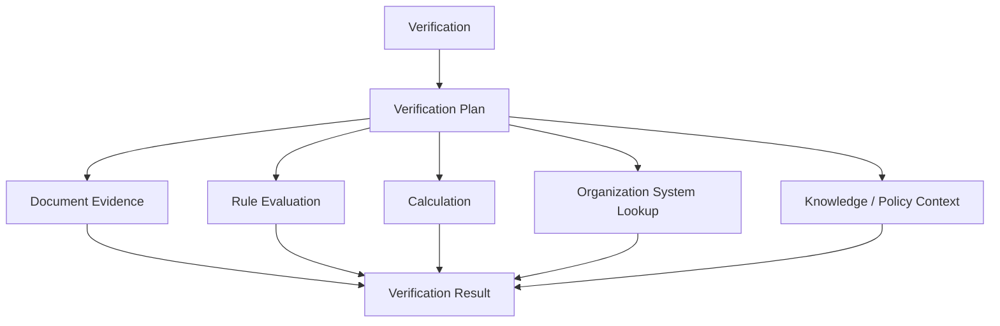

A Verification is therefore a **business question**, while rules and calculations are mechanisms used to answer it.

---

## 11. AI Agent Architecture

### Agent Architecture Diagram

The four agents specialize reasoning tasks while sharing Case State and using controlled tools rather than directly mutating business state.

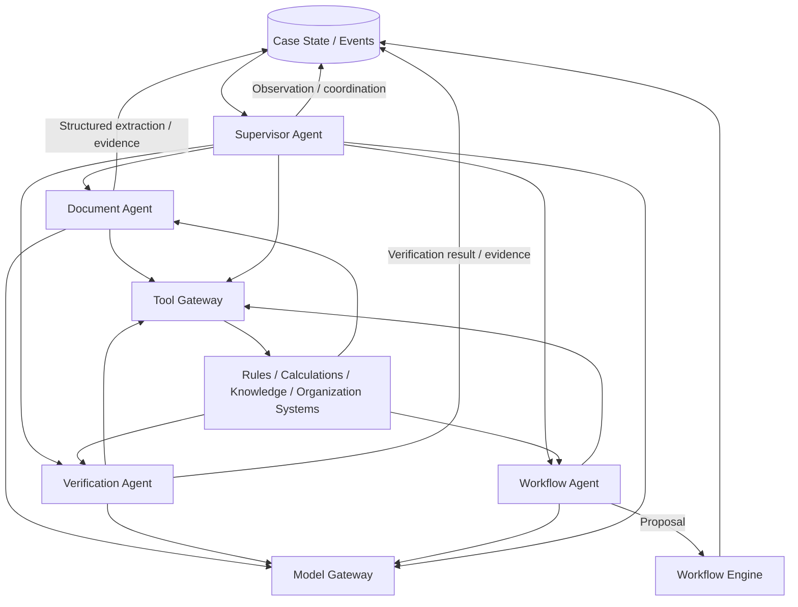

Verifia uses four main AI-driven agents.

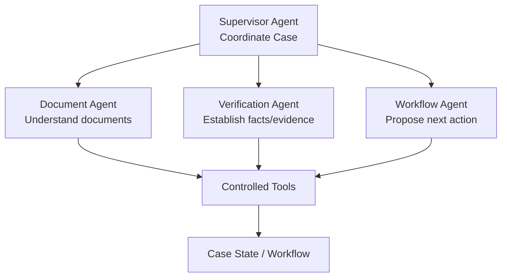

Knowledge retrieval is treated primarily as a **service/tool capability**, not as a fifth agent merely for symmetry.

---

## 12. Agent Responsibilities

### 12.1 Supervisor Agent

The Supervisor coordinates one explicit case request synchronously. It builds a bounded, organization-scoped snapshot for the Case and its immutable ProcessVersion, validates a finite plan, and can delegate sequentially to at most one each of the Document, Verification, and Workflow Agents. It returns a structured `CONTINUE`, `ESCALATE`, `COMPLETE`, or `NEEDS_INFORMATION` decision. A plan is limited to three child calls.

Each delegated execution records `parent_execution_id`, linking it to the Supervisor's `AgentExecution`; this preserves case-level traceability without introducing a queue or durable orchestration loop. The Supervisor calls child-agent services only. The child agents retain their own authorization and Tool Gateway paths.

It:

- reads the current Case state,
- understands the current objective,
- identifies outstanding work,
- delegates to specialized agents,
- interprets results,
- determines whether more information is needed,
- returns a coordination decision,
- determines whether human intervention is needed,
- communicates results.

It does **not**:

- perform unscoped database access (case context reads are organization-scoped),
- directly mutate business state,
- call arbitrary tools,
- recurse into another Supervisor,
- bypass permissions,
- perform critical calculations,
- approve a case without configured authority.

### 12.2 Document Agent

Responsibilities:

```text
File
 ↓
Validation
 ↓
Parser / OCR
 ↓
Text + Tables
 ↓
Classification
 ↓
LLM Extraction
 ↓
Schema Validation
 ↓
Normalized Data + Evidence
```

Low-confidence extraction can create a human-review task.

### 12.3 Verification Agent

The Verification Agent determines what must be established and coordinates the evidence required to establish it.

It can use:

- extracted document fields,
- document comparisons,
- deterministic rules,
- deterministic calculations,
- knowledge retrieval,
- authoritative organization-system tools.

It interprets deterministic results but does not override them.

### 12.4 Workflow Agent

The Workflow Agent reasons about what should happen next based on:

- current Case state,
- process configuration,
- requirements,
- verification results,
- human decisions,
- policies,
- and available actions.

It proposes a transition/task/action.

It does **not** directly change workflow state.

```text
Workflow Agent
      ↓
Proposed Transition
      ↓
Workflow Engine
      ↓
Policy / Permission Validation
      ↓
Execute
      ↓
Case State
      ↓
Event
```

---

## 13. AI Loop vs. Business Workflow Loop

### AI Responsibility vs Deterministic Execution vs Human Judgment

The three responsibility zones are deliberately separated. AI handles flexible reasoning; deterministic services enforce repeatable facts and policies; humans provide authoritative judgment where configured.

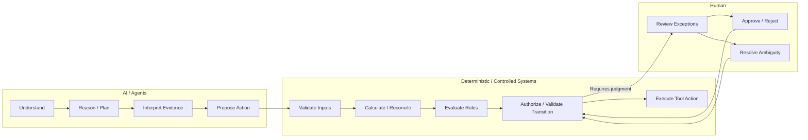

### Business Workflow vs AI Orchestration

These are separate graphs: the AI graph coordinates reasoning and tool use, while the business workflow graph governs authoritative process state.

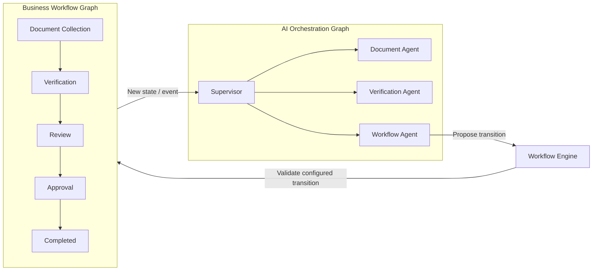

These are deliberately different systems.

### AI loop

```text
OBSERVE
   ↓
REASON
   ↓
DELEGATE
   ↓
USE TOOLS
   ↓
INTERPRET RESULTS
   ↓
PROPOSE ACTION
```

### Business loop

```text
CASE STATE
   ↓
CHECK REQUIREMENTS
   ↓
VALIDATE TRANSITION
   ↓
EXECUTE
   ↓
NEW CASE STATE
   ↓
EVENT
```

### Why the distinction matters

AI reasoning is flexible and probabilistic.

Business state transitions are controlled and deterministic.

> **LangGraph / AI orchestration is not the business workflow.**

---

## 14. Model Gateway and Hybrid AI Strategy

Agents should not be tightly coupled to a model provider.

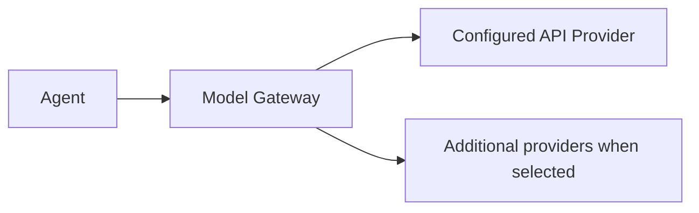

### Project direction

The project currently uses Groq Qwen 3.8 27B as the Document Agent's configured API model. The Verification Agent currently shares the configured JSON adapter as a runtime baseline; that is not a model-quality decision for Verification, and live inference/evaluation for it has not been performed. Workflow and Supervisor use the existing JSON adapter interface; dedicated model selection and live quality evaluation remain deferred to the model integration/evaluation phases.

Use fake/injected adapters for repeatable agent behavior and safety tests during Phases 12 and 13. Phase 14 establishes the shared provider-neutral Model Gateway and may perform live API connectivity and structured-output smoke checks. Comparative model quality evaluation belongs to Phase 23, after agent contracts are stable.

The current implementation direction is API-hosted inference using synthetic and non-sensitive demo data. Gemini and local inference are not selected requirements. Additional providers can be added through the gateway if later evaluation or deployment needs justify them.

### Principle

> **Do not hard-code the provider into the agent.**

---

## 15. Agent Tools and Tool Gateway

Tools are the controlled interface between AI reasoning and the real system.

```text
Agent
  ↓
Structured Tool Request
  ↓
Tool Gateway
  ↓
Authentication / Authorization / Policy
  ↓
Tool Execution
  ↓
Structured Result
  ↓
Agent
```

### Tool categories

#### Case tools

```text
get_case()
get_case_history()
get_case_state()
```

#### Document tools

```text
list_documents()
read_document()
extract_document()
search_document()
```

#### Knowledge tools

```text
search_company_knowledge()
search_policy()
search_sop()
```

#### Verification tools

```text
validate_requirements()
compare_documents()
run_verification()
```

#### Deterministic computation tools

```text
calculate_tax()
reconcile_financial_records()
calculate_invoice_total()
calculate_trade_duty()
```

#### Organization-system tools

```text
check_inventory()
get_customer_data()
check_payment_status()
get_employee_data()
check_order_status()
```

#### Workflow tools

```text
get_current_stage()
get_available_transitions()
create_task()
request_approval()
propose_transition()
```

#### Communication tools

```text
send_notification()
request_missing_document()
```

### Tool contract

Every deterministic or system tool should have:

- defined input schema,
- defined output schema,
- authoritative source,
- validation behavior,
- failure behavior,
- permission requirements,
- audit/execution record.

Example:

```json
{
  "tool": "reconcile_financial_records",
  "input": {
    "record_a": 500000,
    "record_b": 500000,
    "tolerance_policy": "exact"
  },
  "output": {
    "status": "MATCH",
    "difference": 0,
    "source": "configured_finance_service",
    "execution_id": "exec_782"
  }
}
```

---

## 16. Deterministic Verification and Computation

The deterministic layer is not a collection of simplistic calculations. It is Verifia's governed execution and verification infrastructure.

### Three categories

#### 1. Decision / Rule tools

- business rule evaluation,
- decision tables,
- policy checks,
- approval conditions.

#### 2. Domain computation tools

- financial reconciliation,
- tax computation,
- invoice calculations,
- duty / trade calculations,
- currency conversion,
- ratios and date calculations,
- specialized domain services.

#### 3. System verification tools

- ERP lookups,
- accounting records,
- inventory,
- HR,
- banking,
- shipping,
- other authoritative organization systems.

### Example verification

```text
Verification: Income Reconciliation
                ↓
        Required Inputs
                ↓
       Financial Statement
       Revenue Report
                ↓
      Reconciliation Service
                ↓
        MATCH / MISMATCH
                ↓
      Verification Result
```

The AI should not decide which deterministic result is correct.

> **AI interprets deterministic facts; configured rules and policies determine the allowed business outcome.**

### Deterministic result example

```text
status: MISMATCH
expected: 500000
actual: 480000
difference: -20000
matched_fields: [...]
mismatched_fields: [...]
calculation_details: {...}
source: Finance System
execution_id: exec_91
```

The Verification Agent may conclude:

> A discrepancy exists and the configured process requires review.

It should not independently conclude that the discrepancy is fraud or invent a new business rule.

---

## 17. Document Intelligence

Documents are treated as **data, never as instructions**.

### Pipeline

```text
Upload
  ↓
File Validation
  ↓
Parser / OCR
  ↓
Text + Tables
  ↓
Document Classification
  ↓
Structured Extraction
  ↓
Schema Validation
  ↓
Normalized Data
  ↓
Evidence / Provenance
  ↓
Case State
```

### Supported inputs

- PDF
- scanned PDF
- images
- DOCX
- XLSX / CSV
- plain text

### Extraction result

```json
{
  "field": "invoice.quantity",
  "value": 500,
  "confidence": 0.98,
  "source": "invoice.pdf",
  "page": 1
}
```

This evidence can later support a Verification Result.

---

## 18. Knowledge and RAG

Each organization has an isolated knowledge base.

Potential sources:

- company policies,
- SOPs,
- internal procedures,
- approval rules,
- product catalogs,
- required-document definitions,
- regulatory/reference material,
- organizational guidelines.

### Pipeline

```text
Organization Knowledge
        ↓
Parser / OCR
        ↓
Chunking
        ↓
Embedding
        ↓
Vector Search
        ↓
Relevant Context
        ↓
Agent Reasoning
```

### Important distinction

The vector store is **retrieval infrastructure**, not business memory.

```text
PostgreSQL
    = business truth / case state

Vector Store
    = semantic retrieval

Agent Context
    = temporary reasoning context
```

Every retrieval must be filtered by `organization_id`.

---

## 19. Workflow Engine

The Workflow Engine is the authority on allowed business-state transitions.

### Workflow definition

```text
Process Version
├── Stages
├── Requirements
├── Transitions
├── Rules / Conditions
├── Roles
├── Approval Policies
└── Actions
```

### Transition model

```text
Current Stage
     ↓
Requested Transition
     ↓
Check:
  • Is transition configured?
  • Are requirements satisfied?
  • Are required verifications complete?
  • Does the actor/tool have authority?
  • Is approval required?
     ↓
ALLOW / REJECT
```

### Example

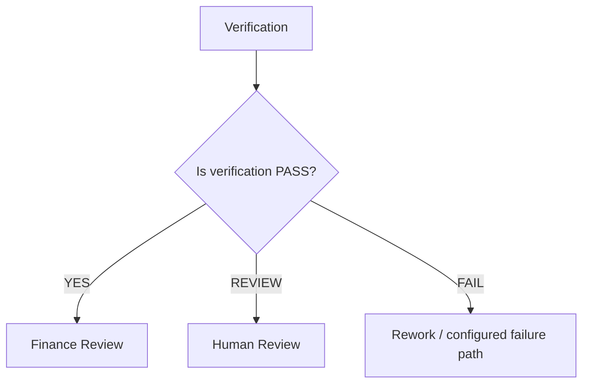

The MVP uses a focused Verifia workflow engine implemented as a controlled state-machine layer. It is intentionally behind an interface so a more advanced durable workflow runtime can be introduced later if needed.

---

## 20. Human-in-the-Loop and Exceptions

### Security / Authorization Flow

Security is enforced around actions and data access; the model is not the authority. Agents operate with controlled permissions and every consequential action is validated before execution.

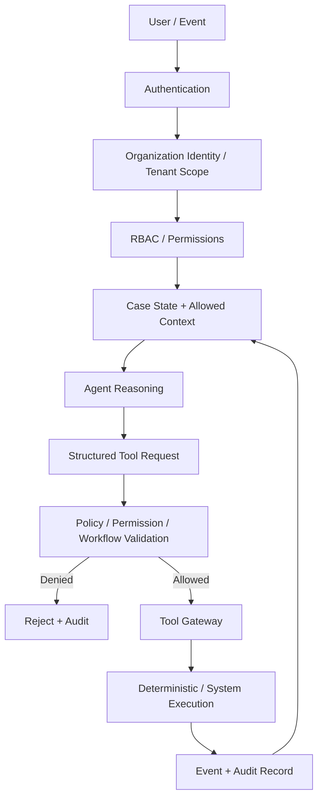

Human involvement is a first-class capability.

### Verification outcomes

```text
PASS
FAIL
REVIEW
NOT_APPLICABLE
INCONCLUSIVE
```

A configured process may map these results to different workflow paths.

### Human review

```text
Agent / Deterministic Service
          ↓
Potential Issue / Uncertainty
          ↓
Create Review Task
          ↓
Employee
          ↓
Decision + Comment + Evidence
          ↓
Case State Updated
          ↓
Workflow Continues
```

### Exception model

Verifia should distinguish between:

1. **Unexpected but interpretable** — the agent can investigate and propose the configured exception path.
2. **Unsafe or unknown** — the case is escalated for human review.

AI cannot invent a new business rule to resolve an unknown situation.

Organization configuration can define:

- fallback stages,
- escalation roles,
- allowed exception actions,
- approval requirements,
- retry behavior.

Configuration changes themselves are controlled and auditable; agents do not autonomously rewrite business policy.

---

## 21. Case State, Memory and Events

Verifia does not require chatbot-style persistent AI memory.

### Source of truth

```text
CASE STATE
   +
EVENTS
   +
EVIDENCE
   +
TOOL RESULTS
   +
HUMAN DECISIONS
```

Agents can be mostly stateless between invocations.

Their context is reconstructed from the authoritative Case State plus relevant Events and Knowledge.

### Events

Examples:

```text
CASE_CREATED
DOCUMENT_UPLOADED
DOCUMENT_PROCESSED
FIELDS_EXTRACTED
MISSING_DOCUMENT_DETECTED
VERIFICATION_STARTED
VERIFICATION_COMPLETED
TASK_CREATED
TASK_COMPLETED
APPROVAL_GRANTED
APPROVAL_REJECTED
WORKFLOW_TRANSITIONED
CASE_COMPLETED
```

### Event principle

> **An event means something happened. It does not mean every component should react blindly.**

The orchestration layer decides what AI work should happen next, while the Workflow Engine decides what business transition is allowed.

---

## 22. End-to-End Runtime Flow

### Case Lifecycle Sequence Diagram

This sequence shows one complete case from intake through document processing, deterministic verification, human review, approval, and completion.

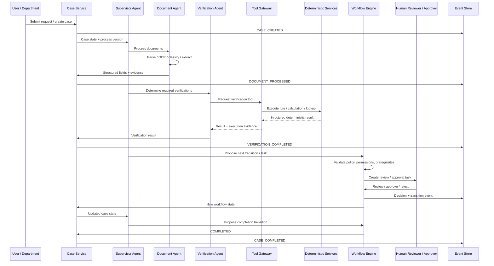

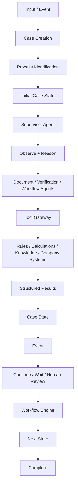

### Waiting states

A Case may wait for:

- customer,
- employee,
- manager,
- external system,
- scheduled event.

When the relevant event occurs, the Case becomes eligible for the next configured action.

---

## 23. Import / Export Demonstration Workflow

### Import / Export Example Architecture

This concrete configuration demonstrates how the generic Verifia engine can support a trade workflow without hard-coding Import / Export logic into the core.

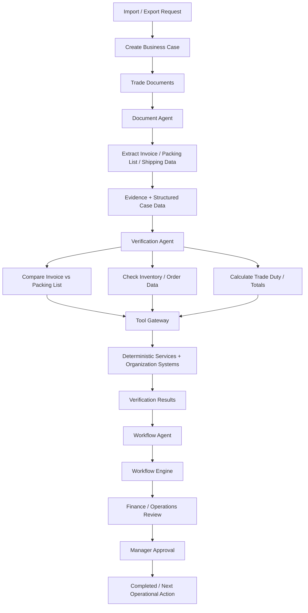

Import / Export is the primary demonstration configuration used to prove that the generic engine works.

### Example request

> “I want to import 500 units of Product A and 200 units of Product B.”

### Configured process

```text
Customer Request
      ↓
Customer Information
      ↓
Product Selection
      ↓
Document Collection
      ↓
Document Verification
      ↓
Inventory Check
      ↓
Finance Review
      ↓
Manager Approval
      ↓
Shipping
      ↓
Completed
```

### Example evidence

```text
Purchase Order: 500 units
Invoice:        500 units
Delivery Note:  480 units
                    ↓
              MISMATCH
                    ↓
              REVIEW TASK
```

### Example inventory check

```text
Requested: 500
Available: 700
Reserved:  100

Result: Available
```

The inventory result is retrieved through a controlled organization-system tool rather than guessed by the LLM.

### Full demonstration sequence

```text
1. User submits a natural-language request.
2. Supervisor understands the request.
3. Case is created against a configured Process Version.
4. Document Agent processes submitted documents.
5. Knowledge service retrieves relevant organization policy.
6. Verification Agent determines required checks.
7. Deterministic tools perform calculations / comparisons.
8. Workflow Agent proposes the next business action.
9. Workflow Engine validates the transition.
10. A human task is created when configured.
11. Employee completes the task.
12. Verification re-runs where required.
13. Manager approval is recorded when required.
14. Case transitions to the next valid state.
15. Audit/events preserve the full history.
16. User receives a status/update.
```

---


---

*Back to [index](00-README.md) · Previous: [Product Overview](01-product-overview.md) · Next: [Database Schema →](03-database-schema.md)*
