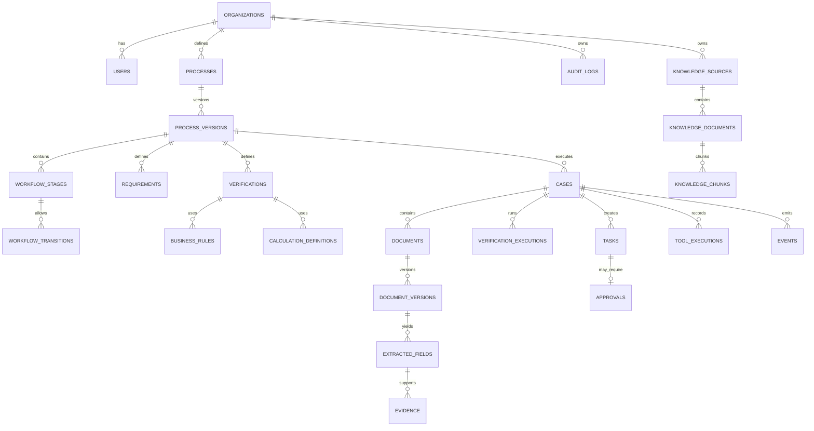
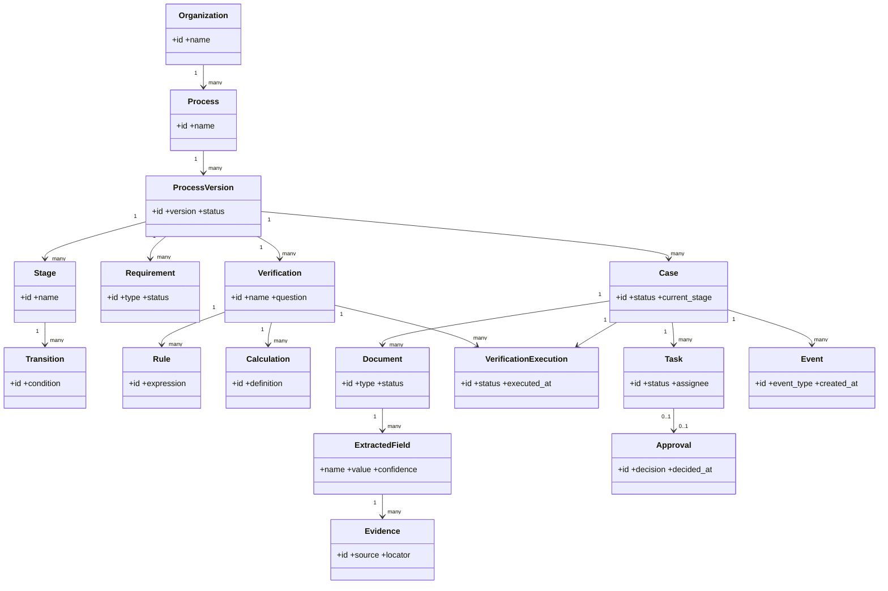

# VerifiaAI Documentation — Part 3: Database Schema

*Back to [index](00-README.md) · Previous: [Architecture](02-architecture.md) · Next: [Operations & Roadmap →](04-operations-and-roadmap.md)*

---

## 24. Database Architecture

### PostgreSQL Entity-Relationship Diagram

PostgreSQL is the authoritative store for organizational configuration, case state, verification results, tasks, approvals, and audit/event history. Large document binaries remain in object storage and are referenced by metadata.



PostgreSQL is the authoritative operational database.

### Logical areas

```text
VERIFIA DATABASE
│
├── Organization & Security
│   ├── organizations
│   ├── users
│   ├── departments
│   ├── roles
│   ├── permissions
│   └── user_roles
│
├── Process Configuration
│   ├── processes
│   ├── process_versions
│   ├── workflow_stages
│   ├── workflow_transitions
│   ├── requirements
│   ├── verifications
│   ├── business_rules
│   └── calculation_definitions
│
├── Runtime / Cases
│   ├── cases
│   ├── case_participants
│   ├── case_data
│   └── case_stage_history
│
├── Documents & Evidence
│   ├── documents
│   ├── document_versions
│   ├── extracted_fields
│   ├── evidence
│   └── evidence_items
│
├── Verification
│   ├── verification_executions
│   ├── verification_results
│   ├── rule_executions
│   └── calculation_executions
│
├── Tasks & Decisions
│   ├── tasks
│   └── approvals
│
├── Tools & Integrations
│   ├── tool_definitions
│   ├── tool_executions
│   ├── integrations
│   └── integration_configs
│
├── Knowledge
│   ├── knowledge_sources
│   ├── knowledge_documents
│   └── knowledge_chunks
│
├── AI
│   ├── agent_definitions
│   ├── agent_executions
│   └── model_configs
│
└── Events / Audit
    ├── events
    ├── audit_logs
    └── notifications
```

Original files and processed artifacts should live behind an object-storage abstraction; PostgreSQL stores metadata and references.

---

## 25. Database Entity Model

### UML Domain / Class Diagram

The domain model distinguishes reusable process definitions from runtime case data, evidence, work, and decisions.



The class diagram above is the single source of truth for these relationships; the configuration entities (Organization → Process → Process Version → Stages/Requirements/Verifications/Rules/Calculations) and the runtime entities (Case → Documents/Evidence/Verification Executions/Tasks/Approvals/Events) are its two natural halves, as described in [§6, The Three-Layer Architecture](#6-the-three-layer-architecture).

---

## 26. Database Tables

### 26.1 Organizations

```text
organizations
----------------------------
id                  UUID PK
name                VARCHAR
slug                VARCHAR
status              VARCHAR
settings            JSONB
created_at          TIMESTAMP
updated_at          TIMESTAMP
```

### 26.2 Users

```text
users
----------------------------
id                  UUID PK
organization_id     UUID FK
email               VARCHAR
name                VARCHAR
status              VARCHAR
token_version       INTEGER NOT NULL DEFAULT 0
created_at          TIMESTAMP
updated_at          TIMESTAMP
```

Migration `0009_global_user_email_identity` enforces case-insensitive global email uniqueness with a preflight that rejects duplicate legacy identities. Migration `0010_user_token_version` adds the per-user token version; logout and password changes increment it so previously issued access tokens are rejected.

Current identity constraint:

```text
UNIQUE INDEX users(lower(email))
```

### 26.3 Departments

```text
departments
----------------------------
id                  UUID PK
organization_id     UUID FK
name                VARCHAR
description         TEXT
created_at          TIMESTAMP
```

### 26.4 Roles

```text
roles
----------------------------
id                  UUID PK
organization_id     UUID FK
name                VARCHAR
description         TEXT
```

### 26.5 Permissions

```text
permissions
----------------------------
id                  UUID PK
code                VARCHAR UNIQUE
description         TEXT
```

### 26.6 Role permissions

```text
role_permissions
----------------------------
role_id             UUID FK
permission_id       UUID FK
PRIMARY KEY(role_id, permission_id)
```

### 26.7 User roles

```text
user_roles
----------------------------
user_id             UUID FK
role_id             UUID FK
PRIMARY KEY(user_id, role_id)
```

### 26.8 Processes

```text
processes
----------------------------
id                  UUID PK
organization_id     UUID FK
name                VARCHAR
code                VARCHAR
description         TEXT
status              VARCHAR
created_at          TIMESTAMP
updated_at          TIMESTAMP
```

Recommended constraint:

```text
UNIQUE(organization_id, code)
```

### 26.9 Process versions

```text
process_versions
----------------------------
id                  UUID PK
process_id          UUID FK
version_number      INTEGER
status              VARCHAR
configuration       JSONB
created_by          UUID FK
created_at          TIMESTAMP
published_at        TIMESTAMP
```

Recommended constraint:

```text
UNIQUE(process_id, version_number)
```

A published version used by a Case must remain stable.

### 26.10 Workflow stages

```text
workflow_stages
----------------------------
id                  UUID PK
process_version_id  UUID FK
name                VARCHAR
code                VARCHAR
description         TEXT
stage_order         INTEGER
is_initial          BOOLEAN
is_terminal         BOOLEAN
created_at          TIMESTAMP
```

### 26.11 Workflow transitions

```text
workflow_transitions
----------------------------
id                  UUID PK
process_version_id  UUID FK
from_stage_id       UUID FK
to_stage_id         UUID FK
name                VARCHAR
code                VARCHAR
condition_config    JSONB
requires_approval   BOOLEAN
created_at          TIMESTAMP
```

### 26.12 Requirements

```text
requirements
----------------------------
id                  UUID PK
process_version_id  UUID FK
stage_id            UUID FK
name                VARCHAR
code                VARCHAR
type                VARCHAR
description         TEXT
required            BOOLEAN
configuration       JSONB
created_at          TIMESTAMP
```

Possible types:

```text
DOCUMENT
DATA
VERIFICATION
HUMAN_REVIEW
APPROVAL
```

### 26.13 Verifications

```text
verifications
----------------------------
id                  UUID PK
process_version_id  UUID FK
stage_id            UUID FK
name                VARCHAR
code                VARCHAR
description         TEXT
result_policy       JSONB
created_at          TIMESTAMP
```

### 26.14 Business rules

```text
business_rules
----------------------------
id                  UUID PK
process_version_id  UUID FK
name                VARCHAR
code                VARCHAR
description         TEXT
rule_type           VARCHAR
expression          JSONB
severity            VARCHAR
created_at          TIMESTAMP
```

Business rules should use a safe declarative representation rather than arbitrary executable Python supplied as configuration.

### 26.15 Verification rules

```text
verification_rules
----------------------------
verification_id     UUID FK
rule_id             UUID FK
execution_order     INTEGER
required            BOOLEAN
PRIMARY KEY(verification_id, rule_id)
```

### 26.16 Calculation definitions

```text
calculation_definitions
----------------------------
id                  UUID PK
process_version_id  UUID FK
name                VARCHAR
code                VARCHAR
description         TEXT
calculation_type    VARCHAR
configuration       JSONB
created_at          TIMESTAMP
```

### 26.17 Cases

```text
cases
----------------------------
id                  UUID PK
organization_id     UUID FK
process_id          UUID FK
process_version_id  UUID FK
case_number         VARCHAR
title               VARCHAR
status              VARCHAR
current_stage_id    UUID FK
created_by          UUID FK
created_at          TIMESTAMP
updated_at          TIMESTAMP
completed_at        TIMESTAMP
metadata            JSONB
```

The Case explicitly references the Process Version it executes.

### 26.18 Case participants

```text
case_participants
----------------------------
id                  UUID PK
case_id             UUID FK
user_id             UUID FK NULL
participant_type    VARCHAR
name                VARCHAR
external_reference  VARCHAR
created_at          TIMESTAMP
```

### 26.19 Case data

```text
case_data
----------------------------
id                  UUID PK
case_id             UUID FK
field_name          VARCHAR
field_value         JSONB
source_type         VARCHAR
source_reference    VARCHAR
confidence          NUMERIC
created_at          TIMESTAMP
updated_at          TIMESTAMP
```

### 26.20 Documents

```text
documents
----------------------------
id                  UUID PK
case_id             UUID FK
document_type       VARCHAR
name                VARCHAR
status              VARCHAR
uploaded_by         UUID FK
storage_reference   TEXT
created_at          TIMESTAMP
updated_at          TIMESTAMP
```

### 26.21 Document versions

```text
document_versions
----------------------------
id                  UUID PK
document_id         UUID FK
version_number      INTEGER
storage_reference   TEXT
file_hash           VARCHAR
mime_type           VARCHAR
file_size           BIGINT
uploaded_by         UUID FK
created_at          TIMESTAMP
```

### 26.22 Extracted fields

```text
extracted_fields
----------------------------
id                  UUID PK
document_version_id UUID FK
field_name          VARCHAR
field_value         JSONB
confidence          NUMERIC
page_number         INTEGER
bounding_box        JSONB
extraction_method   VARCHAR
created_at          TIMESTAMP
```

### 26.23 Evidence

```text
evidence
----------------------------
id                  UUID PK
case_id             UUID FK
verification_execution_id UUID FK NULL
evidence_type       VARCHAR
description         TEXT
created_at          TIMESTAMP
```

### 26.24 Evidence items

```text
evidence_items
----------------------------
id                  UUID PK
evidence_id         UUID FK
source_type         VARCHAR
source_id           UUID
field_reference     VARCHAR
value_snapshot      JSONB
page_number         INTEGER
location            JSONB
created_at          TIMESTAMP
```

Verification evidence bundles link to their execution. Evidence items can reference
source documents, extracted fields, successful tool executions, rule traces,
calculation traces, knowledge, or other authoritative sources. Tool result links
are validated to belong to the same case as the verification.

### 26.25 Verification executions

```text
verification_executions
----------------------------
id                  UUID PK
case_id             UUID FK
verification_id     UUID FK
status              VARCHAR
started_at          TIMESTAMP
completed_at        TIMESTAMP
executed_by_type    VARCHAR
executed_by_id      UUID NULL
created_at          TIMESTAMP
```

### 26.26 Verification results

```text
verification_results
----------------------------
id                       UUID PK
verification_execution_id UUID FK
result                   VARCHAR
summary                  TEXT
confidence               NUMERIC
reason                   TEXT
created_at               TIMESTAMP
```

Allowed results should include:

```text
PASS
FAIL
REVIEW
NOT_APPLICABLE
INCONCLUSIVE
```

### 26.27 Rule executions

```text
rule_executions
----------------------------
id                  UUID PK
verification_execution_id UUID FK
rule_id             UUID FK
input_data          JSONB
result              VARCHAR
output_data         JSONB
executed_at         TIMESTAMP
execution_id        VARCHAR
```

### 26.28 Calculation executions

```text
calculation_executions
----------------------------
id                  UUID PK
verification_execution_id UUID FK
calculation_id      UUID FK
input_data          JSONB
output_data         JSONB
status              VARCHAR
executed_at         TIMESTAMP
execution_id        VARCHAR
```

### 26.29 Tasks

```text
tasks
----------------------------
id                  UUID PK
case_id             UUID FK
stage_id            UUID FK NULL
task_type           VARCHAR
title               VARCHAR
description         TEXT
status              VARCHAR
assigned_user_id    UUID FK NULL
assigned_role_id    UUID FK NULL
assigned_department_id UUID FK NULL
created_by_type     VARCHAR
created_by_id       UUID NULL
due_at              TIMESTAMP
completed_at        TIMESTAMP
created_at          TIMESTAMP
updated_at          TIMESTAMP
```

Task lifecycle:

```text
PENDING → ASSIGNED → IN_PROGRESS → COMPLETED
                         └────────→ REJECTED
```

### 26.30 Approvals

```text
approvals
----------------------------
id                  UUID PK
case_id             UUID FK
approval_type       VARCHAR
task_id             UUID FK NULL
required_role_id    UUID FK
requested_at        TIMESTAMP
decided_at          TIMESTAMP
decision             VARCHAR
decided_by          UUID FK
comment             TEXT
```

### 26.31 Tool definitions

```text
tool_definitions
----------------------------
id                  UUID PK
organization_id     UUID FK NULL
name                VARCHAR
code                VARCHAR
description         TEXT
tool_type           VARCHAR
input_schema        JSONB
output_schema       JSONB
permission_code     VARCHAR
enabled             BOOLEAN
created_at          TIMESTAMP
updated_at          TIMESTAMP
```

### 26.32 Tool executions

```text
tool_executions
----------------------------
id                  UUID PK
case_id             UUID FK NULL
tool_id             UUID FK
requested_by_type   VARCHAR
requested_by_id     UUID NULL
input_data          JSONB
output_data         JSONB
status              VARCHAR
error               TEXT
started_at          TIMESTAMP
completed_at        TIMESTAMP
```

### 26.33 Integrations

```text
integrations
----------------------------
id                  UUID PK
organization_id     UUID FK
name                VARCHAR
integration_type    VARCHAR
status              VARCHAR
created_at          TIMESTAMP
updated_at          TIMESTAMP
```

### 26.34 Integration configuration

```text
integration_configs
----------------------------
id                  UUID PK
integration_id      UUID FK
config_metadata     JSONB
secret_reference    TEXT
created_at          TIMESTAMP
updated_at          TIMESTAMP
```

Secrets should be kept in an appropriate secret-management mechanism rather than stored as plaintext configuration.

### 26.35 Knowledge sources

```text
knowledge_sources
----------------------------
id                  UUID PK
organization_id     UUID FK
name                VARCHAR
source_type         VARCHAR
description         TEXT
status              VARCHAR
created_at          TIMESTAMP
```

### 26.36 Knowledge documents

```text
knowledge_documents
----------------------------
id                  UUID PK
knowledge_source_id UUID FK
title               VARCHAR
document_version    VARCHAR
storage_reference   TEXT
content_hash        VARCHAR
created_at          TIMESTAMP
```

### 26.37 Knowledge chunks

```text
knowledge_chunks
----------------------------
id                  UUID PK
knowledge_document_id UUID FK
chunk_index         INTEGER
content             TEXT
embedding           VECTOR
metadata            JSONB
created_at          TIMESTAMP
```

### 26.38 Agent definitions

```text
agent_definitions
----------------------------
id                  UUID PK
organization_id     UUID FK NULL
name                VARCHAR
agent_type          VARCHAR
description         TEXT
model_config_id     UUID FK
enabled             BOOLEAN
created_at          TIMESTAMP
```

### 26.39 Model configurations

```text
model_configs
----------------------------
id                  UUID PK
provider            VARCHAR
model_name          VARCHAR
endpoint            TEXT NULL
configuration       JSONB
created_at          TIMESTAMP
```

### 26.40 Agent executions

```text
agent_executions
----------------------------
id                  UUID PK
case_id             UUID FK
agent_id            UUID FK
parent_execution_id UUID FK NULL → agent_executions.id (ON DELETE SET NULL)
input_context       JSONB
output              JSONB
status              VARCHAR
started_at          TIMESTAMP
completed_at        TIMESTAMP
token_usage         JSONB NULL
error               TEXT NULL
```

`parent_execution_id` links a delegated agent execution to its parent Supervisor execution. Migration `0007_agent_execution_parent` adds this self-reference and indexes it alone and with `case_id` for trace lookup. The link records execution lineage; it does not grant authority or change case state.

### 26.41 Events

```text
events
----------------------------
id                  UUID PK
organization_id     UUID FK
case_id             UUID FK NULL
event_type          VARCHAR
actor_type          VARCHAR
actor_id            UUID NULL
payload             JSONB
created_at          TIMESTAMP
```

Trusted case-orchestration events also have one durable outbox row in `event_deliveries`. Event history remains append-only; delivery status is operational state and may change as workers claim, retry, complete, or dead-letter the event. Migration `0011_durable_event_deliveries` adds this table after `0010_user_token_version`.

#### Event delivery outbox

```text
event_deliveries
----------------------------
id                  UUID PK
event_id            UUID FK UNIQUE -> events.id (ON DELETE CASCADE)
status              VARCHAR(24)   # PENDING, PROCESSING, RETRY, COMPLETED, DEAD_LETTER
attempts            INTEGER
available_at        TIMESTAMP WITH TIME ZONE
lease_until         TIMESTAMP WITH TIME ZONE NULL
lease_token         VARCHAR(36) NULL
completed_at        TIMESTAMP WITH TIME ZONE NULL
last_error_code     VARCHAR(100) NULL
created_at          TIMESTAMP
updated_at          TIMESTAMP
```

The event row and trusted outbox row are committed in the same database transaction. `lease_token` fences stale workers from completing a delivery claimed by another worker. Delivery is at least once; orchestration uses persisted dispatch results to suppress duplicate completed work. A handler that performs an external side effect before recording its result still requires an idempotency key at that external system.

### 26.42 Audit logs

```text
audit_logs
----------------------------
id                  UUID PK
organization_id     UUID FK
actor_type          VARCHAR
actor_id            UUID NULL
action              VARCHAR
resource_type       VARCHAR
resource_id         UUID
before_state        JSONB
after_state         JSONB
ip_address          INET NULL
metadata            JSONB
created_at          TIMESTAMP
```

### 26.43 Notifications

```text
notifications
----------------------------
id                  UUID PK
organization_id     UUID FK
case_id             UUID FK NULL
recipient_user_id   UUID FK
notification_type   VARCHAR
title               VARCHAR
message             TEXT
status              VARCHAR
created_at          TIMESTAMP
read_at             TIMESTAMP
```

### 26.44 Case stage history

```text
case_stage_history
----------------------------
id                  UUID PK
case_id             UUID FK
from_stage_id       UUID FK NULL
to_stage_id         UUID FK
transition_id       UUID FK NULL
triggered_by_type   VARCHAR
triggered_by_id     UUID NULL
reason              TEXT
created_at          TIMESTAMP
```

This provides a direct business-state history in addition to the general event stream.

---

## 27. Data Integrity, Versioning and Multi-Tenancy

### 27.1 Process versioning

A Process can evolve:

```text
Tax Verification
   ├── v1
   ├── v2
   └── v3
```

A Case is bound to one version:

```text
Case #1042 → Tax Verification v2
```

New configuration must not silently alter existing Cases.

### 27.2 Definition vs runtime

```text
DEFINITION
Process
Process Version
Stage
Requirement
Verification
Rule
Calculation
Transition

RUNTIME
Case
Document
Extracted Field
Evidence
Verification Execution
Task
Approval
Tool Execution
Event
```

### 27.3 Multi-tenancy

Every organization-owned record must be scoped to its organization either directly or through an unambiguous ownership relationship.

Application-level checks should be reinforced with database-level protections where appropriate, including PostgreSQL Row-Level Security for sensitive deployments.

### 27.4 Immutability

The following should be treated as append-only or effectively immutable after publication/execution:

- published Process Versions,
- executed calculations,
- verification executions/results,
- approvals,
- audit records,
- historical events.

Corrections should create new records/versioned state rather than silently rewriting history.

### 27.5 Important indexes

```text
cases(organization_id)
cases(organization_id, status)
cases(organization_id, current_stage_id)
cases(process_version_id)
documents(case_id)
documents(case_id, document_type)
tasks(case_id)
tasks(assigned_user_id, status)
verification_executions(case_id)
events(case_id, created_at)
events(organization_id, created_at)
audit_logs(organization_id, created_at)
audit_logs(resource_type, resource_id)
```

A pgvector index should be selected according to the deployed pgvector version and retrieval workload.

---


---

*Back to [index](00-README.md) · Previous: [Architecture](02-architecture.md) · Next: [Operations & Roadmap →](04-operations-and-roadmap.md)*
