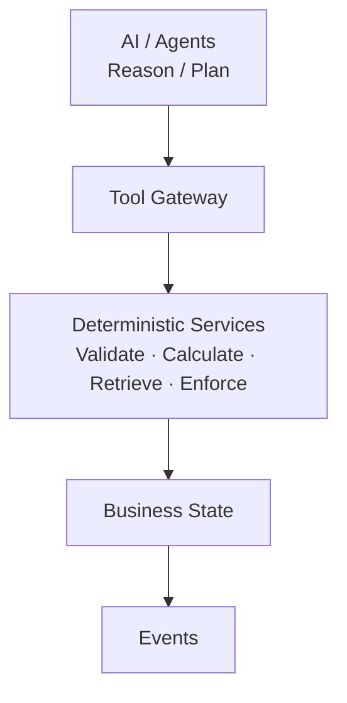
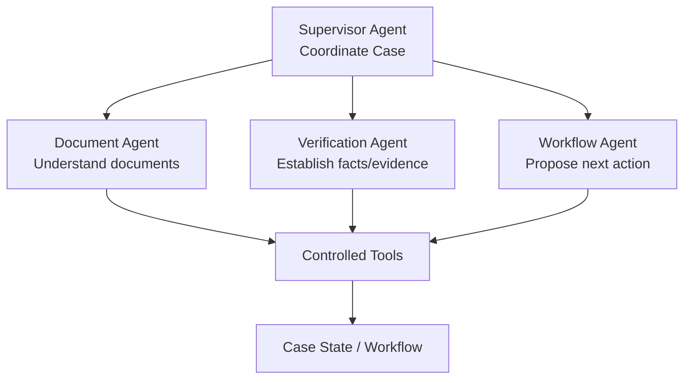
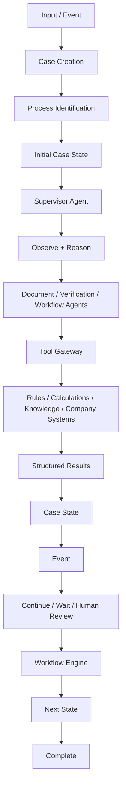

# VerifiaAI — Project Summary

*A configurable, AI-orchestrated platform for business processes that depend on documents, evidence, rules, calculations, and human judgment.*

---

## What it is

Think of any process that moves through several people and several documents before a decision gets made: invoice verification, contract review, import/export compliance, insurance claims, tax checks. **Verifia automates and orchestrates business processes that require understanding, verification, evidence, rules, calculations, and human decisions** — using AI to reason and propose, and deterministic infrastructure to verify and decide.

## The problem it solves

Today, that kind of work looks like this in most organizations:

```mermaid
flowchart LR
    A[Request] --> B[Document Collection]
    B --> C[Employee Reads Documents]
    C --> D[Information Extraction]
    D --> E[Requirement Checks]
    E --> F[Cross-Document Comparison]
    F --> G[Calculations / Rules]
    G --> H[Department Review]
    H --> I[Manager Approval]
    I --> J[Execution]
    J --> K[Notification]
```

Every arrow above is a place things go wrong: slow processing, repetitive manual work, data-entry and calculation errors, missing or inconsistent documents, no one sure what step comes next, and — worst of all for audits — no clear record of *why* a decision was made the way it was.

## The core idea

The obvious, weak version of this project would be "point an LLM at documents and let it decide things." Verifia deliberately does **not** do that. Its central design decision is a strict separation of responsibility into three zones:

> **AI provides flexible reasoning. Deterministic systems provide reliable verification and execution. Humans provide authoritative judgment.**

Concretely: an AI agent can read a contract, reason about what it implies, and *propose* a next action — but it never directly executes anything or writes to the database. Every proposal passes through a **Tool Gateway** into deterministic services (rule engines, calculators, permission checks) that actually validate and execute it. Only after that does the result become official case state, which then triggers an event and, where configured, a human approval step.

This is the part worth emphasizing: it's not "can an LLM automate this," it's **"how do you let an LLM participate in a business process without letting it become an unaccountable source of truth."** The LLM never gets to be the final word on a calculation or a compliance check — it navigates and reasons, but a deterministic system enforces the actual rule.

## How the AI side is structured

A Supervisor Agent coordinates specialized agents, each with a narrow job:

None of these agents write to the database directly — they all act through the same controlled Tool Gateway, which is what makes the system auditable: every action an agent takes is a logged, permissioned tool call, not a free-form side effect.

## Made concrete: a worked example

The demonstration case is import/export verification. A shipment case comes in with a commercial invoice, packing list, and customs declaration.

A Document Agent reads and extracts the figures. A Verification Agent checks them against configured rules (do the quantities reconcile? does the declared value match the invoice?) — but the *reconciliation math itself* runs in a deterministic calculation service, not in the model's head. If something fails or falls into a gray area, a human reviewer gets a task with the evidence attached, and their decision — not the AI's guess — becomes the record. When everything checks out, a Workflow Agent proposes the case move to the next stage, and a workflow engine (not the agent) validates that the transition is actually allowed before it happens.

## Why this is a strong design

- **It's generic, not hardcoded.** The import/export flow is a *configuration* of the platform — stages, rules, and requirements defined as data — not logic baked into code. The same engine could be reconfigured for contract review or claims processing without touching the core.
- **It's auditable by construction.** Because every AI action passes through a deterministic gate before becoming state, and every state change emits an event, you get a complete, explainable trail of *why* a case ended up where it did — the exact thing manual processes struggle to provide.
- **It's not model-locked.** Agents talk to a Model Gateway rather than a specific provider, so the reasoning engine underneath can change without redesigning the system.

## In one sentence

**Verifia automates and orchestrates business processes that require understanding, verification, evidence, rules, calculations, and human decisions — using AI to reason and propose, and deterministic infrastructure to verify and decide.**
