# VerifiaAI Presentation Draft

**Working title:** Why Is Reliable Automation Hard for Document-Heavy Business Processes?  
**Course:** Agentic AI and Generative AI Systems  
**Presenter:** [Your name]  
**Instructor:** [Instructor]  
**Date:** [Presentation date]  
**Target delivery:** 12–15 minutes, including a short Q&A

## Presentation intent

This presentation follows the reasoning behind the project. It starts with the problem and its scope, then explains what generative AI and agentic AI can contribute, why the system needs clear control boundaries, and what Verifia has implemented so far. Import/Export is the running example of a broader class of evidence-driven business processes.

The diagrams below are editable Mermaid source. The document-processing implementation has been tested with generated fixtures and a deterministic fake model adapter. A live synthetic smoke request confirmed that the Gemini 3.8 Flash API adapter returns parseable JSON; representative-document quality and the Tesseract OCR executable have not been validated.

---

## Slide 1 — Why Is Reliable Automation Hard for Document-Heavy Business Processes?

### On-slide content

**Verifia: the problem-led design of an AI system**

Agentic AI and Generative AI Systems  
Presented by [Your name]  
[Instructor] · [Date]

### Diagram

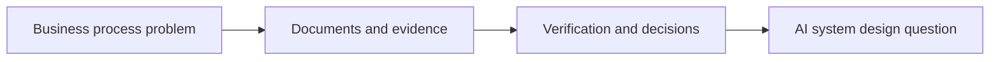

### Speaker notes

We chose this project because many organizational processes depend on information that arrives in documents and then moves through several checks and decisions. The hard part is more than reading a file. A process may require understanding different documents, comparing their claims, applying rules, and deciding what should happen when something does not match.

Our main question is: **How can AI help with this work while keeping the result explainable and controlled?** I’ll walk through the problem that led us to Verifia’s design, explain why we chose a configurable platform, and show what we have implemented so far.

---

## Slide 2 — Which Processes Are in Scope?

### On-slide content

**Verifia targets processes that depend on:**

- Documents and evidence
- Cross-checks, rules, or calculations
- Organizational data
- Human review or approval

**Examples:** trade operations, procurement, finance, compliance, insurance  
**Import/Export is our demonstration process.**

### Diagram

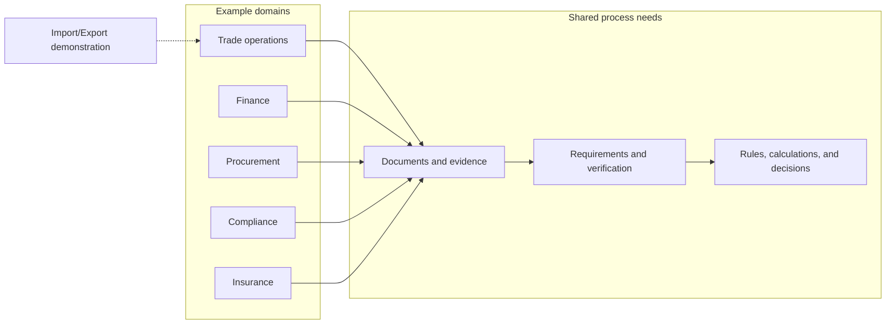

### Speaker notes

We first needed to define the project’s scope. Verifia focuses on case-based business processes where someone must gather information, establish what the evidence says, check it against requirements, and route the case through decisions.

That pattern appears in several domains. An import shipment is our demonstration because it brings together invoices, purchase orders, packing lists, inventory checks, and approvals. The project is generic because those needs recur across different processes. Organizations configure stages, requirements, rules, calculations, document schemas, and permitted tools within a shared platform.

This is a bounded scope. Verifia is designed for evidence-driven business processes rather than general automation of every organizational task.

---

## Slide 3 — One Shipment, Several Documents

### On-slide content

**An import case may contain:**

- Purchase order: what the buyer ordered
- Invoice: what the supplier charges
- Packing list: what the shipment contains
- Inventory or payment records: what the organization knows

**Question:** Do these sources describe the same transaction?

### Diagram

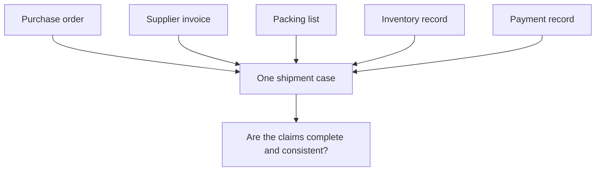

### Speaker notes

We’ll use one shipment as our running example. The purchase order records what the buyer agreed to buy. The invoice records what the supplier wants to charge. The packing list describes what was shipped. Internal systems may contain inventory or payment information.

Each source answers a different question. To process the case, an employee has to combine them and determine whether the transaction is complete and consistent. A single document rarely contains enough information to establish that on its own.

---

## Slide 4 — The Information Is Fragmented

### On-slide content

**The same fact can appear in different forms.**

- Supplier names may vary between files
- Dates and amounts may use different formats
- Documents may be scanned, tabular, or text-based
- Every extracted value needs a source and location

**A copied value without provenance is hard to verify.**

### Diagram

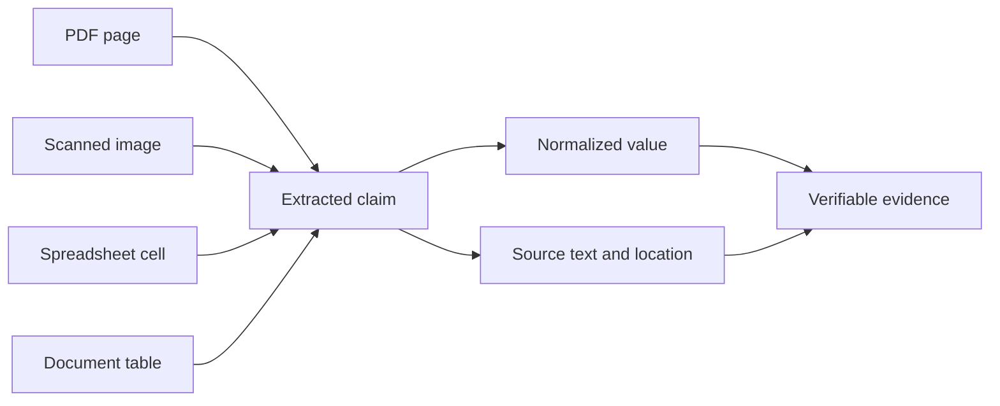

### Speaker notes

The first difficulty is fragmentation. Relevant information may be spread across a PDF, a spreadsheet, a scanned image, and an internal system. The same value may use different formatting or slightly different wording.

That creates two separate needs. The system has to interpret the content, and it has to preserve where each extracted value came from. If an employee or reviewer asks where an amount originated, the system should be able to point back to a document and location.

For that reason, Verifia treats source information and provenance as part of the data, rather than presenting extracted values alone.

---

## Slide 5 — Each Check Depends on Earlier Work

### On-slide content

**A case may require several connected checks:**

- Are all required documents present?
- Do the invoice and purchase order agree?
- Do quantities and totals make sense?
- Is an exception ready for a person to review?

**An early mistake can affect later decisions.**

### Diagram

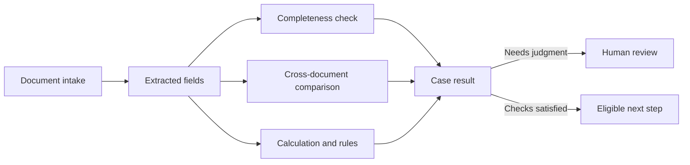

### Speaker notes

The second difficulty is dependency. A comparison depends on correct extraction from both documents. A calculation depends on valid numbers and clear rules. A decision about whether the case is ready may depend on required documents, external records, and a person’s authority.

These steps also affect one another. If the model reads a total incorrectly, a later comparison may flag a false discrepancy. If a document is missing, the system may need to request it instead of continuing. We therefore have to reason about the whole case process, including what evidence supports each result and what should happen when a check cannot be completed.

---

## Slide 6 — Generative AI Helps Interpret Varied Documents

### On-slide content

**Generative AI can help with:**

- Classifying a document
- Extracting fields into a defined structure
- Returning confidence and cited source text
- Handling variation in layout and wording

**The extracted result still needs validation.**

### Diagram

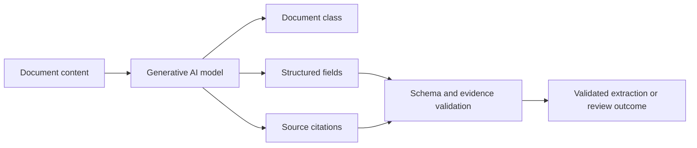

### Speaker notes

Generative AI is useful where document content varies in layout and wording. In Verifia’s document-processing foundation, a model adapter classifies documents and extracts fields according to configured schemas.

The output contract includes confidence and citations to parsed source blocks. The system checks that the cited text exists, validates the values against their schema, and flags results that require review. This approach gives the model a bounded task and gives the rest of the system a structured result it can validate.

The automated suite uses deterministic fake adapters for repeatability. Groq Qwen 3.8 27B is configured for the Document Agent, and its small generated-document evaluation passed classification, field matching, and citation checks. This is a smoke evaluation, not a broad accuracy benchmark. The Verification Agent currently shares the configured JSON adapter at runtime, but its live inference quality has not been evaluated.

---

## Slide 7 — Why Consider Multiple Agents?

### On-slide content

**The process contains different reasoning responsibilities.**

- Document role: establish facts from sources
- Verification role: answer configured business questions
- Workflow role: propose a valid next step
- Supervisor role: coordinate work across the case

**Each role needs a clear input, output, and boundary.**

### Diagram

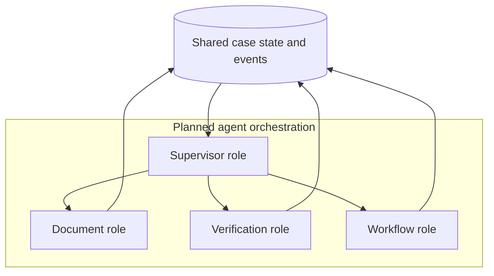

### Speaker notes

We considered a multi-agent design because the case contains distinct responsibilities. Understanding what a document says differs from deciding whether a configured requirement is satisfied. Proposing what should happen next differs from executing that action.

Separate roles can make those responsibilities clearer and give each one a defined contract. The agents can exchange structured results through case state and events. The number of agents should serve the process’s real divisions of work. Adding agents without clear responsibilities would add coordination overhead.

This is the project’s target architecture. The current agent service remains a proposal scaffold, so agent-to-agent orchestration is not yet implemented.

---

## Slide 8 — Why This System Structure?

### On-slide content

**Different components handle different responsibilities.**

- Generative AI interprets content and proposes results
- The Tool Gateway checks permitted tool use
- Deterministic services apply rules and calculations
- Workflow validation controls state changes
- People review exceptions and make approvals

**Evidence and events retain the decision trail.**

### Diagram

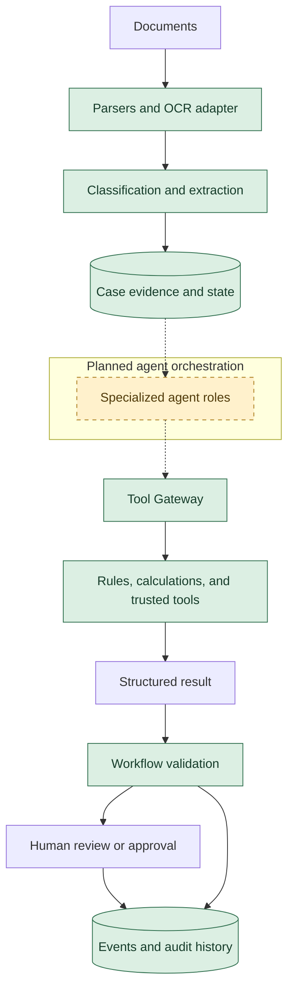

**Legend:** Green components are implemented foundations. The dashed amber component is planned.

### Speaker notes

This structure follows from the problem’s reliability requirements. Generative AI can interpret varied content and produce structured proposals. The Tool Gateway provides a controlled path for tools, with authorization, schema validation, and execution records. Rules and calculations provide predictable results for checks that can be expressed deterministically. The Workflow Engine validates process transitions, while tasks and approvals provide a path for human judgment.

The components work together around case data, evidence, and events. This keeps model output useful while preserving a clear record of what the system processed and what decision or action followed.

The Tool Gateway and deterministic foundations are implemented. The agents are not yet connected to that gateway.

---

## Slide 9 — Shipment Walkthrough

### On-slide content

**The invoice total differs from the purchase order.**

1. Verifia extracts both values with source citations
2. A configured check compares them
3. The discrepancy is recorded with its evidence
4. A pending review task is created

**The task remains unassigned for manual pickup.**

### Diagram

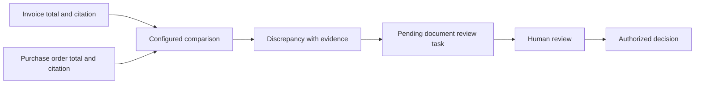

### Speaker notes

Imagine the invoice shows a total that differs from the purchase order. The document-processing flow extracts the relevant values and retains their source text and locations. A configured verification can then compare them and record whether they match.

If extraction confidence is low or a validation warning occurs, the processing run records a review-required status and creates a pending document-review task. The task is currently unassigned, so a reviewer-routing policy remains future work. The process does not silently treat an uncertain model output as a final business decision.

---

## Slide 10 — What Has Been Built?

### On-slide content

**Implemented foundations**

- Configurable cases, process versions, and workflows
- Deterministic rules, calculations, and verification
- Policy-enforced Tool Gateway
- Versioned document storage and processing records
- Parsing, classification, extraction, citations, and review-task creation

**Latest backend suite: 63 tests passed**

### Diagram

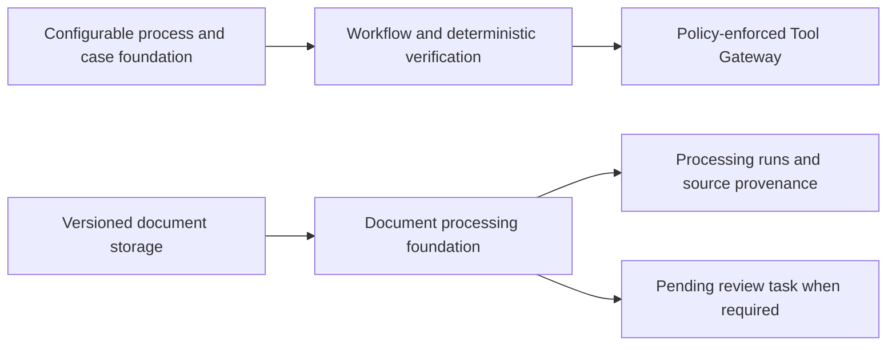

**Test note:** Document-processing tests use generated fixtures and a deterministic fake model adapter.

### Speaker notes

The project has moved beyond a concept diagram. The backend includes configurable process and case foundations, workflow validation, rules, calculations, verification, and a Tool Gateway with policy checks and execution records.

Document uploads use versioned storage. The current document-intelligence work adds parsers, an OCR adapter, configurable classification and extraction contracts, source citations, processing-run provenance, and review-task creation. The latest full backend test run passed 63 tests.

That test result demonstrates the current software contracts and behaviors. In particular, document-processing tests use generated fixtures and a deterministic fake model adapter. They do not establish live model accuracy.

---

## Slide 11 — What Still Needs Validation?

### On-slide content

**Open work**

- Expand Document Agent evaluation with varied documents and OCR noise
- Implement Workflow and Supervisor agent contracts and safety tests
- Build the provider-neutral Model Gateway; perform API smoke checks after the agent contracts stabilize
- Compare agent models against repeatable evaluations in Phase 23
- Add durable background processing and retries
- Define reviewer assignment and system adapters

**The agentic target is ahead of the current implementation.**

### Diagram

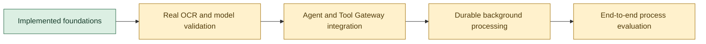

### Speaker notes

We also want to be precise about what remains. The local environment does not have the Tesseract executable, so OCR has been tested through a mocked adapter rather than on real scanned examples. The Gemini adapter has not yet been evaluated against representative documents because its API key is not configured.

The current processing endpoint runs inline. The queue module does not provide a durable worker. Agent orchestration and agent calls through the Tool Gateway also remain future implementation work. These are important because the project’s final goal is an agentic process platform, while the current system has completed several of the controlled foundations that such a platform needs.

---

## Slide 12 — The Problem Defines the Architecture

### On-slide content

**Reliable automation must connect:**

- Understanding of documents
- Evidence and validation
- Controlled tools and process state
- Human judgment and an audit trail

**Verifia’s design follows from those requirements.**

**Closing question:** What should AI decide, and what should it recommend?

### Diagram

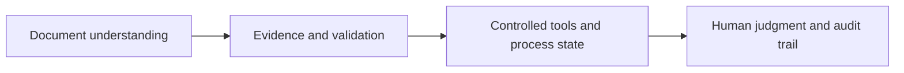

### Speaker notes

We began with a problem: business processes require people to interpret varied documents, compare information, apply rules, and route uncertain cases. That combination makes reliable automation difficult.

Our design gives generative AI a role in interpreting documents and producing evidence-linked results. It gives deterministic services responsibility for configured checks and calculations. It gives the Tool Gateway responsibility for controlled tool access, and it preserves human review for exceptions and approvals.

The project’s strength lies in treating these needs as parts of one system. The next challenge is validating the AI components with real data and connecting the planned agents to the controls already in place. I’d like to discuss where the boundary should sit between an AI recommendation and an authorized business decision.

---

## Optional reference slide

Keep this after the closing slide or in the appendix.

- VerifiaAI Documentation, `01-product-overview.md`
- VerifiaAI Documentation, `02-architecture.md`
- VerifiaAI Documentation, `Verifia_Detailed_Implementation_Checklist.md`
- VerifiaAI Documentation, `progress_report.md`

These sources document the project’s scope, architecture, implementation plan, and current status.
